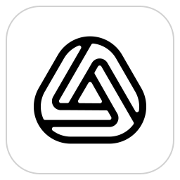

# noshape

A fast, fully local, parametric feature-based CAD application for macOS, Linux and Windows.
noshape works like Onshape — documents with Part Studios, Assemblies and Drawings, a
history-based feature list, constraint-driven sketches, mates, and a version graph with
branches and merges — but runs entirely on your machine. No account, no server, no network.

Built with Rust, [GPUI](https://gpui.rs) via [GPUI Kit](https://gpui-kit.com), wgpu, and the
OpenCascade (OCCT) B-rep kernel.

## What it does

**Documents.** A `.noshape` file is a local database holding every change as a
microversion. There is no Save command. You get undo/redo, named versions, branches,
merges, read-only views of any point in history, and "compare with current". A start
window lists recent documents and folders with thumbnails.

**Part Studios**
- **Sketches:** lines, arcs, circles, splines, conics, slots, polygons and text.
- **Sketch constraints:** a dual-number Levenberg–Marquardt solver, DOF display,
  inference and snapping.
- **Driving dimensions:** values can be expressions, e.g. `#width / 2 + 1/4 in`.
- **Features:** extrude, revolve, sweep, loft, thicken, fillet, chamfer, shell, draft,
  holes, patterns, mirror, booleans, split, surfaces, curves, direct edits, and more.
- **Sheet metal:** flanges, hems, tabs, bends, joints, reliefs, corner breaks, and a flat
  pattern exported to DXF/SVG.
- **Frames:** trim, gussets, end caps and a cut list.
- **Feature dialogs:** every dialog previews live. Dialogs have a "Final" toggle, and
  some features have drag handles in the viewport (extrude depth, revolve angle).
- **Persistent naming:** downstream references survive upstream edits.
- **History list:** rollback bar, suppression, reordering, folders, and copy/paste of
  features (also between documents).
- **Variables and configurations:** variables, Variable Studios, configurations, and
  Derived parts across Part Studios.
- **Analysis:** measure and mass properties.
- **View:** section view, display modes and named views.
- **Custom features:** defined in script in Feature Studios.

**Assemblies.**
- **Mates:** all Onshape mate types on mate connectors, plus relations, groups, and
  limits.
- **Moving parts:** a triad manipulator, snap mode, and solver-driven drag.
- **Patterns and replicate.**
- **Explode:** exploded views and named positions.
- **Checks and lists:** interference checks and a BOM.

**Drawings.**
- **Views:** generated with hidden-line removal: base, projected, section (including
  jogged and aligned), detail, auxiliary, broken and cropped views.
- **Annotations:** associative dimensions with tolerances, GD&T, notes with fields, a
  title block, and BOM, hole and general tables.
- **Export:** PDF, SVG and DXF.

**Import and export.** Import STEP, IGES and BREP; export STEP, IGES, STL, OBJ and BREP.

## Using noshape from Claude Code and other agents

Every release bundle ships `noshape-cli` next to the app: a command line tool and an MCP server that can do
everything the app does (see [docs/AGENT_API.md](docs/AGENT_API.md)). Add it to Claude Code with the path for
your system:

| Download | Command |
|---|---|
| macOS (`.dmg`, app dragged to Applications) | `claude mcp add noshape -- /Applications/noshape.app/Contents/MacOS/noshape-cli mcp` |
| Linux (`.tar.gz`, unpacked to `~/noshape-<version>-linux-x86_64`) | `claude mcp add noshape -- ~/noshape-<version>-linux-x86_64/noshape-cli mcp` |
| Windows (`.zip`, unpacked to `C:\noshape-<version>-windows-x86_64`) | `claude mcp add noshape -- C:\noshape-<version>-windows-x86_64\noshape-cli.exe mcp` |

Use the folder you actually unpacked to. The dmg also holds a loose `noshape-cli` next to `noshape.app` if you
prefer to put it on your `PATH`. When the app has a document open, the CLI edits it live in the window.

**macOS:** the app and the CLI are signed ad hoc, not notarized, so macOS blocks them when they come from a
download ("cannot be opened" / "developer cannot be verified"). After copying the app to Applications, clear the
download flag once (this covers the CLI inside the app too):

```sh
xattr -dr com.apple.quarantine /Applications/noshape.app
xattr -d com.apple.quarantine /path/to/noshape-cli    # only for a loose copy taken from the dmg
```

## Building

You need Rust (stable), a C++17 compiler and CMake. Build OCCT once, then build the app:

```sh
scripts/build-occt.sh ~/.cache/noshape/occt        # Windows: scripts\build-occt.ps1
export OCCT_ROOT=~/.cache/noshape/occt
cargo run --release -p noshape                    # start window
cargo run --release -p noshape -- --demo /tmp/demo.noshape   # sample document
```

See [docs/USER_GUIDE.md](docs/USER_GUIDE.md) for how to use it, [docs/BUILDING.md](docs/BUILDING.md) for build details, and
[docs/ARCHITECTURE.md](docs/ARCHITECTURE.md) for how the crates fit together.

## Repository layout

| Crate | Purpose |
|---|---|
| `crates/units` | Quantities, units and the expression language |
| `crates/sketch` | 2D constraint solver and sketch tools |
| `crates/kernel` | OCCT bridge (cxx): modeling, booleans, tessellation, HLR, I/O |
| `crates/model` | Documents, features, regeneration, naming, assemblies, drawings |
| `crates/store` | Local versioned storage (SQLite, content-addressed blobs) |
| `crates/render` | wgpu renderer (offscreen, picking, reverse-Z, MSAA) |
| `crates/app` | The GPUI application |
